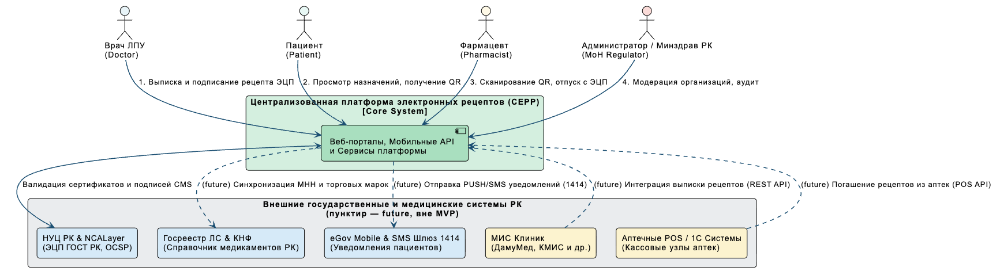
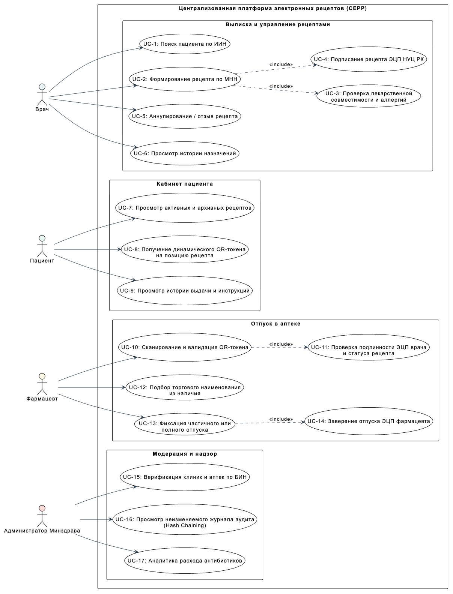
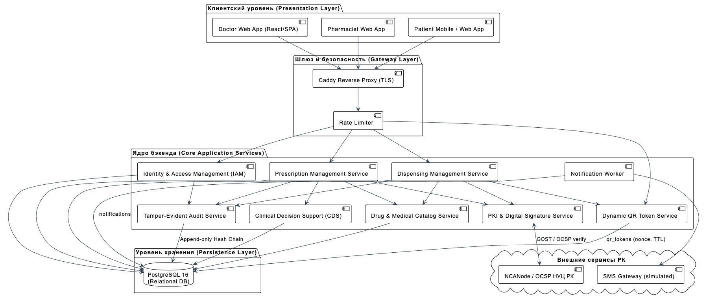
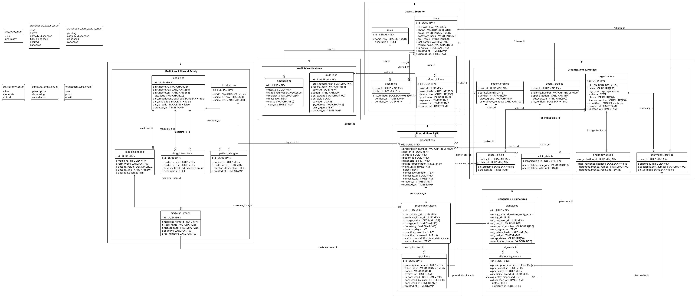

# 07. Architecture and Diagrams

**Status:** draft v0.2 for pre-defense 1. Diagram sources are in [`../diagrams/src`](../diagrams/src) (PlantUML, editable). Rendered exports are in [`../diagrams/export`](../diagrams/export).

| # | Diagram | Required by the university | Source | Export |
|---|---|---|---|---|
| 1 | System context | Yes | `01-system-context.puml` | `system-context.png` |
| 2 | Use case | Yes | `02-use-case.puml` | `use-case.png` |
| 3 | Component (draft) | Yes | `03-component.puml` | `component.png` |
| 4 | Entity–relationship (ERD) | Additional | `04-erd.puml` | `erd.png` |

---

## 1. System context



The platform is one central system used by four roles: **doctor**, **patient**, **pharmacist**, and **administrator**.

External systems used in the MVP:
- **NCALayer** — the standard NCA RK desktop application on the doctor's and pharmacist's computer. The web portal talks to it over a local WebSocket to sign data with the user's EDS key. The private key never leaves the user's machine.
- **NCA RK PKI (OCSP)** — used through the NCANode verifier to check that a certificate is valid and not revoked.
- **SMS gateway** — patient one-time codes and notifications (simulated in the MVP).

External systems shown as **future integrations** (not implemented in the MVP): clinic MIS (Damumed and others), pharmacy POS / 1C, the State Register of Medicines / KNF, and eGov services (Social Wallet, SMS 1414). The REST API is designed so that each of them can be connected later through an adapter.

## 2. Use cases



| ID | Use case | Actor | Requirements |
|---|---|---|---|
| UC-1 | Find patient by IIN | Doctor | FR-D01 |
| UC-2 | Create prescription by INN (with ICD-10 diagnosis) | Doctor | FR-D02, FR-D03 |
| UC-3 | Check allergies and drug interactions *(included in UC-2)* | Doctor | FR-D09 |
| UC-4 | Sign prescription with EDS *(included in UC-2)* | Doctor | FR-D04 |
| UC-5 | Cancel prescription | Doctor | FR-D05 |
| UC-6 | View patient prescription history | Doctor | FR-D06 |
| UC-7 | View active and past prescriptions | Patient | FR-P01, FR-P02 |
| UC-8 | Get dynamic QR token for a prescription item | Patient | FR-P03, FR-P05 |
| UC-9 | View dispensing history and instructions | Patient | FR-P04 |
| UC-10 | Scan and validate QR token | Pharmacist | FR-PH01 |
| UC-11 | Check doctor's signature and prescription status *(included in UC-10)* | Pharmacist | FR-PH02 |
| UC-12 | Choose trade name from stock | Pharmacist | FR-PH03 |
| UC-13 | Record full or partial dispense | Pharmacist | FR-PH03, FR-PH04 |
| UC-14 | Sign the dispense with EDS *(included in UC-13)* | Pharmacist | FR-PH07 |
| UC-15 | Verify clinics and pharmacies by BIN | Administrator | FR-A01, FR-A02 |
| UC-16 | View tamper-evident audit log | Administrator | FR-A04, FR-A05 |
| UC-17 | View prescribing statistics (e.g. antibiotics) | Administrator | FR-A06 |

## 3. Components (draft)



**Style:** modular monolith in Go (decision D6 in `05-technology-comparison.md`). Each module is a Go package with its own handlers, service, and repository. Modules call each other only through service interfaces.

| Layer | Component | Responsibility | Key requirements |
|---|---|---|---|
| Clients | Doctor portal (Next.js) | Issue, sign, cancel prescriptions; patient history | FR-D* |
| | Pharmacist portal (Next.js) | Scan QR, verify, dispense, sign | FR-PH* |
| | Admin portal (Next.js) | Verification, catalogue, audit, statistics | FR-A* |
| | Patient app (React Native) | Prescriptions, QR tokens, history | FR-P* |
| Gateway | Caddy reverse proxy | TLS, rate limiting, routing to the API | NFR-SEC01, NFR-SEC04 |
| Core (Go) | `iam` | EDS login, OTP login, JWT, RBAC | FR-AUTH01–04 |
| | `organizations` | Clinics, pharmacies, doctor and pharmacist profiles, verification | FR-A01, FR-A02 |
| | `catalog` | Medicines (INN), forms, brands, ICD-10 codes | FR-A03, FR-D02 |
| | `cds` | Allergy and drug-interaction checks | FR-D09 |
| | `prescriptions` | Draft, canonical form, signing, cancellation, history | FR-D01–D08, FR-P01–P02 |
| | `pki` | Calls NCANode, stores results in `signatures` | FR-D04, FR-PH07, FR-AUTH01 |
| | `qr` | Issue and validate single-use QR tokens per item | FR-P03, FR-P05 |
| | `dispensing` | Atomic dispensing with row locking | FR-PH01–PH06 |
| | `audit` | Append-only, hash-chained audit log | FR-A04, FR-A05, NFR-SEC05 |
| | `notifications` | Background worker sending SMS/push from the `notifications` table | FR-P07 |
| Separate service | NCANode | GOST/RSA signature verification, certificate chain, OCSP | FR-D04, FR-PH07 |
| Storage | PostgreSQL 16 | All data, including QR tokens and the notification queue | D2, D7 |

**Deployment:** one VPS with Docker Compose: `caddy`, `api` (Go binary), `ncanode`, `postgres`. Web portals are served behind the same proxy. The mobile app is distributed with Expo. No Redis or message broker in the MVP (decision D7).

## 4. Data model



The database has **24 tables in six groups**:

| Group | Tables | Purpose |
|---|---|---|
| 1. Users & security | `users`, `roles`, `user_roles`, `refresh_tokens` | Identity (IIN, phone), roles, sessions |
| 2. Organizations & profiles | `organizations`, `clinic_details`, `pharmacy_details`, `doctor_profiles`, `doctor_clinics`, `pharmacist_profiles`, `patient_profiles` | Clinics and pharmacies (BIN), links between people and organizations |
| 3. Medicines & clinical safety | `medicines`, `medicine_forms`, `medicine_brands`, `icd10_codes`, `patient_allergies`, `drug_interactions` | Catalogue by INN → form → brand; diagnoses; safety reference data |
| 4. Prescriptions & QR | `prescriptions`, `prescription_items`, `qr_tokens` | Prescription header, items with dosage and quantities, QR tokens per item |
| 5. Dispensing & signatures | `dispensing_events`, `signatures` | Each dispense with brand and quantity; every EDS signature with OCSP status |
| 6. Audit & notifications | `audit_logs`, `notifications` | Hash-chained audit trail; outgoing SMS/push queue |

Design notes:
- **Catalogue by INN.** Doctors prescribe by INN and dosage form (`medicine_forms`); the pharmacist records the trade name actually dispensed (`medicine_brands`). This matches the practice of prescribing by international non-proprietary name.
- **Quantities on the item.** `prescription_items.quantity_dispensed` can never exceed `quantity_prescribed` (CHECK constraint). This is the last line of defence against over-dispensing even if application logic fails.
- **One signatures table.** `signatures` stores doctor signatures (prescription, cancellation) and pharmacist signatures (dispensing), with signer IIN, certificate serial, OCSP status, and verification result.
- **QR tokens store only a hash.** `qr_tokens.token_hash` is stored, never the token itself, so a database leak does not expose valid tokens.
- **Audit chain.** Each `audit_logs` row stores `prev_record_hash` and `record_hash = SHA-256(prev_record_hash || canonical record)`. The application database role has `INSERT` and `SELECT` only on this table.
- **Login methods.** Doctors and pharmacists log in with EDS, patients with phone + OTP. `users.password_hash` is therefore nullable and used only for administrator accounts.

## 5. Key scenarios

### 5.1 Issue and sign a prescription (UC-1 … UC-4)
1. The doctor finds the patient by IIN, selects the diagnosis (ICD-10), and adds items by INN and dosage form with structured dosage.
2. The `cds` module checks the items against `patient_allergies` and `drug_interactions` and returns warnings. The doctor can change the items or confirm.
3. The server builds the canonical JSON of the prescription. The browser asks NCALayer to sign it.
4. The `pki` module sends the CMS signature to NCANode. Signing is accepted only if (a) the signature is valid, (b) the certificate is valid and not revoked, (c) the signer's IIN equals the logged-in doctor's IIN, and (d) the signed content matches the stored draft.
5. The prescription becomes `active`; a `signatures` row and an audit record are written; the patient is notified.

### 5.2 Patient shows a QR code (UC-7, UC-8)
1. The patient opens an active prescription item in the app.
2. The app requests a QR token for that item. The server creates a random token, stores its hash with a nonce and an expiry (90 s), and returns it. The app requests a new token every 60 s.
3. The QR code contains only the opaque token, with no name, IIN, or medicine.

### 5.3 Verify and dispense (UC-10 … UC-14)
1. The pharmacist scans the QR code. The server finds the token by hash and checks that it is not expired and not consumed.
2. The pharmacist sees the item, remaining quantity, doctor, clinic, and the doctor's signature status, then chooses the trade name and quantity.
3. The pharmacist signs the dispensing record with EDS through NCALayer; the `pki` module verifies it.
4. In **one database transaction** the server: locks the item row (`SELECT … FOR UPDATE`), checks status, expiry, and remaining quantity, marks the QR token as consumed, updates `quantity_dispensed` and the statuses, inserts `dispensing_events` and `signatures`, and writes an audit record. If any check fails, the transaction is rolled back and the attempt is logged.

Anti-reuse relies on three layers: **single-use, short-lived QR tokens**, **row locking inside one transaction**, and the **CHECK constraint** on quantities.

### 5.4 Prescription lifecycle

```
DRAFT ──sign──► ACTIVE ──partial dispense──► PARTIALLY_DISPENSED ──last item dispensed──► FULLY_DISPENSED
                  │                                   │
                  ├──cancel (doctor)──► CANCELLED      ├──cancel──► CANCELLED
                  └──valid_until passed──► EXPIRED     └──valid_until passed──► EXPIRED
```

Each prescription item has its own status: `pending → partially_dispensed → dispensed`, or `cancelled`.

## 6. Security architecture

| Threat | Mitigation |
|---|---|
| Forged prescription | Only prescriptions with a verified doctor EDS signature become ACTIVE; the pharmacist sees the signature status |
| Prescription edited after signing | Signed content is immutable; any change requires cancellation and a new prescription |
| Fake or disputed dispense | Every dispense is signed with the pharmacist's EDS and linked to the pharmacy |
| Over-dispensing / double dispense | Single-use QR token + row lock in one transaction + CHECK constraint |
| Replay of a QR screenshot | Token expires after 90 s and is consumed on first dispense |
| Stolen session | Short-lived access token; signing still requires the EDS key and PIN |
| Insider changes history | Append-only, hash-chained audit log with an integrity check |
| Brute force on OTP / manual codes | Rate limiting and lockout |
| Data leak | TLS, hashed tokens, minimal personal data in API responses, encrypted backups |

## 7. Personal data inventory (NFR-PRIV01)

| Data | Tables | Why needed | Who can see it |
|---|---|---|---|
| IIN, name, phone | `users` | Identify patients and clinicians | Patient (own), treating doctor, pharmacist during dispense, admin |
| Date of birth, gender | `patient_profiles` | Prescription form, dosing context | Patient, doctors, pharmacist during dispense |
| Allergies | `patient_allergies` | Clinical safety checks | Patient, doctors |
| Diagnosis, prescribed medicines | `prescriptions`, `prescription_items` | Core function | Patient, doctors, pharmacist during dispense (diagnosis hidden from pharmacist) |
| Dispensing records | `dispensing_events` | Core function | Patient, issuing doctor, dispensing pharmacy, admin |

The MVP uses **synthetic data only**. No real patient data is stored during development or evaluation.

## 8. Architectural decisions (summary)

| ADR | Decision | Alternatives | Reason |
|---|---|---|---|
| ADR-1 | Modular monolith in Go | Microservices, serverless | One transaction for dispensing; small team (doc 05, D1, D6) |
| ADR-2 | PostgreSQL only | PostgreSQL + Redis, + message broker | Row locks, constraints, and one source of truth for QR tokens (D2, D7) |
| ADR-3 | REST + OpenAPI | gRPC, GraphQL | Simple for web and mobile; documented contract for future integrations (D3) |
| ADR-4 | NCALayer + NCANode for EDS, doctor and pharmacist signatures | Kalkan SDK via cgo, own GOST implementation | Correctness and isolation (D4) |
| ADR-5 | Central database + hash-chained audit log, no blockchain | Blockchain-based double-spend prevention | Trusted operator model; much lower complexity (literature review) |
| ADR-6 | Single-use QR token per prescription item | One static QR per prescription; signed QR with full data | Partial dispensing per item; privacy; replay protection |
| ADR-7 | Integrations with state systems, MIS, and POS as future work | Implement in MVP | Keeps the MVP achievable; API designed for later adapters |
